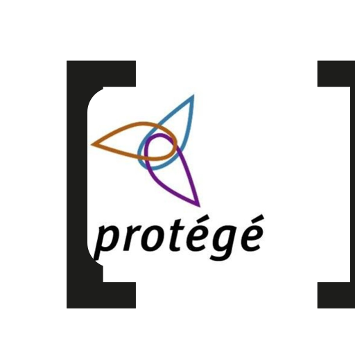

# protege-owl-array: OWL-array reasoners for Protégé

**rdf-array** reasoner plugin for [Protégé](https://protege.stanford.edu/) 5.6. With
[owlapi-array](https://github.com/rdf-array/owlapi-array)'s OWL API bundle in place of Protégé's,
Protégé reads a list `( … )` as one term, OWL's own lists exactly as before and a list in the data as
a sequence. This plugin adds two entries to the Reasoner menu that know what the
[OWL-array](https://rdf-array.github.io/rdf-array/docs/owl-array.html) built-ins mean (`ra:member`,
`ra:length`, `ra:first`, `ra:last`, …):

- **HermiT 1.4.3 (OWL-array)**: the HermiT that Protégé bundles, behind owlapi-array's
  `SequenceAwareReasonerFactory`, which gives the reasoner each sequence's expansion (owl-array.md
  §6), closure included. The ontology you edit is not changed.
- **ELK 0.6.0 (OWL-array)**: the bundled ELK behind the same expansion without the closure, which
  OWL 2 EL cannot express. ELK skips anonymous individuals, so it sees no data held in blank nodes.

Part of the [rdf-array](https://github.com/rdf-array/rdf-array) organisation, which is not affiliated
with the Protégé project.

## Installing

`assemble.sh` makes "Protégé 5.6.9 + owlapi-array + this plugin" from the stock platform-independent
zip:

```bash
git clone https://github.com/rdf-array/protege-owl-array.git && cd protege-owl-array
./assemble.sh Protege-5.6.9-owl-array
JAVA_HOME=$(/usr/libexec/java_home -v 21) Protege-5.6.9-owl-array/run.sh   # macOS; elsewhere any JDK 11 or newer
```

It downloads `Protege-5.6.9-platform-independent.zip` from protegeproject/protege-distribution's
release (cached in `~/.cache/protege-owl-array`) and checks its SHA-256 (the digest of the file that
release served on 2026-10-27; its PGP signature was not checked). It unpacks the zip, replaces
`bundles/owlapi-osgidistribution.jar` with owlapi-array's bundle and adds
`plugins/protege-owl-array.jar`. The platform-independent zip brings no Java of its own, so `run.sh`
needs `JAVA_HOME` (or `java_home=` in `conf/jvm.conf`).

There is no release yet, so both jars are built from source, which needs Git, Maven and a JDK. The
script fetches owlapi-array at the commit `OWLAPI_COMMIT` names. It installs owlapi-array's modules into
a Maven repository in the cache, since they carry upstream's coordinates, and packages its OSGi
bundle. Then it builds the plugin from the checkout the script is in. The first run takes some
minutes. Later runs reuse the owlapi-array build for that commit. To use jars you have already built
(or downloaded) instead, name them:

```bash
OWLAPI_BUNDLE=../owlapi-array/osgidistribution/target/owlapi-osgidistribution-4.5.29.jar \
PLUGIN=target/protege-owl-array-0.1.0.jar ./assemble.sh
```

To install by hand, do the same two steps in an existing Protégé 5.6.x: replace
`bundles/owlapi-osgidistribution.jar` and drop the plugin jar into `plugins/`. owlapi-array's bundle
has upstream's symbolic name and version (`org.semanticweb.owl.owlapi` 4.5.29), so every other
plugin resolves against it unchanged.

## Building

The plugin compiles against `protege-editor-owl` 5.6.6 (the last on Maven Central; the reasoner API
is the same in 5.6.9), owlapi-array's `owlapi-apibinding` 4.5.29 and HermiT 1.4.3.456, all
`provided`. Install owlapi-array's modules first, into a Maven repository of their own, since they
carry upstream's version:

```bash
(cd ../owlapi-array && mvn install -pl '!distribution' -DskipTests -Dmaven.javadoc.skip -Dno-javadoc=true -Dgpg.skip -Dmaven.repo.local=$PWD/../.m2-owlapi)
(cd ../owlapi-array && mvn -pl osgidistribution package -DskipTests -Dmaven.javadoc.skip=true -Dno-javadoc=true -Dgpg.skip -Dmaven.repo.local=$PWD/../.m2-owlapi)
mvn package -Dmaven.repo.local=$PWD/../.m2-owlapi
```

`assemble.sh` does the same with a fresh clone and the Maven repository in its cache.

The bundle (`org.rdfarray.protege`, `Bundle-Category: protege`) exports nothing and embeds nothing.
It imports `org.semanticweb.owlapi.rdfarray` from owlapi-array's bundle and `org.semanticweb.HermiT`
from the HermiT plugin. The ELK plugin exports no package, so `ElkSequenceReasonerInfo` takes ELK's
factory from ELK's own reasoner plugin through Protégé's plugin registry.

## Using it

Open an ontology, pick one of the two reasoners in the Reasoner menu, start it, and ask the DL Query
tab. [rdf-array's FHIR example](https://rdf-array.github.io/rdf-array/examples/fhir/) is a
walk-through: the SWAT4LS 2016 FHIR process over today's FHIR RDF, whose repeated elements are lists.
Open its `subjects.ttl`; its catalog resolves the imports. Its 24 DL queries list the same instances
in Protégé as through the OWL API. [The demo](https://rdf-array.github.io/rdf-array/docs/protege-array.html)
walks through it step by step, with screenshots. What to expect:

- **Type names as Protégé shows them.** Protégé names an entity by its `rdfs:label`, so a SNOMED CT
  class is `'sct:Rheumatoid arthritis (disorder)'` in a query, not `sct:Rheumatoid_arthritis-disorder`.
  An ontology's default prefix is taken from the ontology you open.
- **A sequence is never an answer.** Protégé's queries return named individuals, and a sequence is an
  anonymous one ([rdf-array#21](https://github.com/rdf-array/rdf-array/issues/21)). It shows in the
  property assertions by its node ID, `_:seq_…`, until owlapi-array writes `( … )` in Manchester
  syntax.
- **`ra:member only C`** is decided only for a list of named individuals; a list holding blank nodes,
  as every FHIR list does, gets no closure ([rdf-array#20](https://github.com/rdf-array/rdf-array/issues/20)).
- **`xsd:date` stops HermiT.** HermiT refuses a literal of a datatype outside the OWL 2 datatype map,
  and FHIR writes dates as `xsd:date`, `gYear`, `gYearMonth` and `time`. Remove or retype such
  literals before reasoning.
- **Save as Turtle.** RDF/XML cannot write a list holding a literal
  ([rdf-array#18](https://github.com/rdf-array/rdf-array/issues/18)); an ontology loaded from Turtle
  is saved as Turtle.

## The walk-through bundle

`walkthrough/` is a second bundle, not installed by `assemble.sh` unless `WALKTHROUGH=<jar>` is
given. It drives Protégé from the inside when Protégé is started with
`-Drdfarray.walkthrough=<directory>` (through `CMD_OPTIONS` for `run.sh`), and does nothing
otherwise. It waits for the FHIR example's `subjects.ttl`, picks "HermiT 1.4.3 (OWL-array)", types
each query of the example into the DL Query tab (from `walkthrough/src/main/resources/queries.tsv`)
and checks the instances the tab lists. It also paints the inferred types of two observations in the
Individuals tab. It tries ELK as well, saves two of the ontologies as Turtle
and RDF/XML and reads them back, and exits. Swing paints the window into PNG files, so no
screen-recording permission is needed. It writes `walkthrough.txt`, the PNGs, and the saved
documents. It made the screenshots of the FHIR example's §4:

```bash
(cd walkthrough && mvn package -Dmaven.repo.local=$PWD/../../.m2-owlapi)
WALKTHROUGH=walkthrough/target/protege-owl-array-walkthrough-0.1.0.jar ./assemble.sh walk
CMD_OPTIONS="-Drdfarray.walkthrough=$PWD/out" walk/run.sh /path/to/rdf-array/examples/fhir/subjects.ttl
```

## Status

0.1.0, 2026-10-27: the two reasoners, the assembly script and the walk-through; not released, so
`assemble.sh` builds from source. Against the FHIR
example, the OWL-array HermiT answers 24 of 24 queries as expected; the OWL-array ELK answers only
the 2 that expect nothing, since the data is in blank nodes. Protégé itself is unchanged. A
`protege-array` fork would be needed only to list sequences where the UI lists individuals (#21) or
to make Turtle the default format for new ontologies. The code is under the OWL API's terms, the LGPL
3.0 or the Apache License 2.0.
